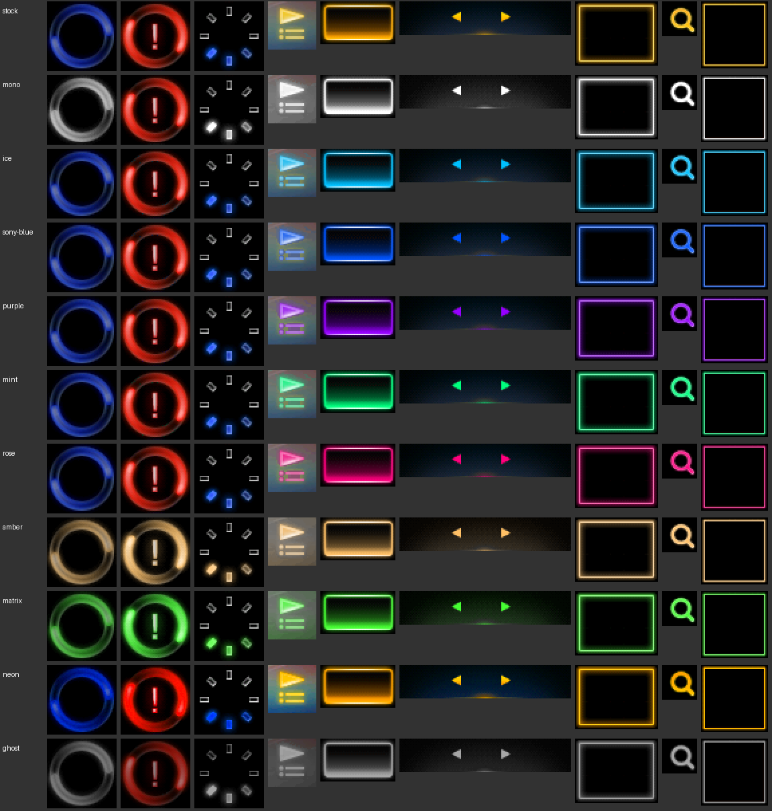

# nwe39x

Custom colour themes, fonts, boot screens and menu tweaks for Sony's **NW-E393 / NW-E394 /
NW-E395** Walkman, made by editing Sony's own firmware updater on your PC.



*The colour presets, applied to a sample of the player's interface pictures (`nwe39x theme NAME
DIR --sheet`). This is a contact sheet of the pictures, not a photo of the screen.*

> [!WARNING]
> **Experimental, and there is no recovery.** If an install leaves the player unable to start,
> there is no known way to get it back: no recovery mode has been found for this player. Only one
> NW-E394 on Sony's firmware 1.01 has been tested. Don't use this on a player you can't afford to
> lose.

## What it is, and isn't

nwe39x takes the updater Sony publishes for this player, changes the pictures, fonts and text
inside it, and installs the result. The player still runs Sony's firmware, with your changes.

- It is **not** Rockbox or a new firmware, and it adds no new features or audio formats.
- It ships **no Sony files**. You download Sony's updater yourself; everything is built on your
  PC.
- Installing needs **Windows** (it talks to the player over USB the way Sony's tool does).
  Building and previewing work wherever Python does.

## What you can change

| | |
|---|---|
| **Colour themes** | ten presets (`mods/theme-*`): mono, ice, sony-blue, purple, mint, rose, amber, matrix, neon, ghost; or any hue |
| **Fonts** | replace the 12 px menu font or the 16 px font from a TrueType or BDF bitmap font |
| **Boot and power-off screens** | from your own picture (128x160) |
| **Text** | any interface string, in any of the 13 languages |
| **Menus** | hide entries such as FM Radio from the home and Settings menus |
| **Volume limit** | remove the regional 17-step cap |

Themes, fonts, pictures and text only replace resources. **Menu and volume changes patch the
player's code**: a wrong one can stop it starting, so `flash` refuses them unless you pass
`--allow-code-patches`.

## Tested

| Player | Sony firmware | Result |
|---|---|---|
| NW-E394 | 1.01 | themes, fonts, boot screens, strings, menu and volume changes; stock restore |
| NW-E393, NW-E395 | 1.01 | **untested.** Sony uses the same updater for all three, so they probably behave the same |
| any | other versions | **untested.** Not supported |

If you try it on an untested combination, please open an issue with the model, the Sony version
(`nwe39x status`), and what happened.

## First run: a colour theme

You need Windows, [uv](https://docs.astral.sh/uv/) (it installs Python for you), and Sony's
updater for the NW-E390 series, version 1.01: `NW-E390_V1_01.exe` from Sony's support site. Check
the file before using it:

```
certutil -hashfile NW-E390_V1_01.exe SHA256
870121a0d373adbbca204120c2018248719c08dda8c5894e4f5048b306c809a4
```

Charge the player, back up your music, and close anything that has the player's drive open.

```
git clone https://github.com/ekelly95/walkman-firmware
cd walkman-firmware
uv sync

uv run nwe39x unpack NW-E390_V1_01.exe             # unpacks Sony's updater into extract/
uv run nwe39x status                               # finds the player, shows its firmware version

uv run nwe39x restore                              # 1. a stock build first: your way back
uv run nwe39x build --mod mods/theme-ice -o out/theme-ice   # 2. the theme
uv run nwe39x diff out/theme-ice/Data/Device/RKNANOFW.IMG   # 3. what changed: pictures, version, CRC
uv run nwe39x flash --updater out/theme-ice        # 4. install; type "flash" when asked
```

The install takes about 15 seconds. The player disconnects, installs, restarts and comes back
reporting the new version. Leave it plugged in and don't touch the drive until `flash` finishes.

**Going back to Sony's look:** `uv run nwe39x flash --updater out/stock-restore`. This works for any
player that still starts; it can't help one that doesn't.

## What `flash` checks first

Before it touches the player, `flash` refuses:

- an image whose changes it can't account for against Sony's original, byte by byte (`nwe39x diff`
  shows the same check);
- an image that fails the checks the player's own installer makes;
- changes to the player's code, unless you pass `--allow-code-patches`;
- any install while there is no stock build in `out/stock-restore` to go back to.

Then it shows what it is about to install, on which player, and waits for you to type `flash`.

## More

- [mods/README.md](mods/README.md): the mods, how to combine them, and how to make your own.
- `uv run nwe39x --help`: every command (exporting pictures, strings and font sheets, previews).
- [NOTES.md](NOTES.md): reverse-engineering notes on the firmware: layout, addresses, how the
  installer works.

## License

GPL-2.0-or-later; see [LICENSE](LICENSE) and [NOTICE](NOTICE). The firmware image format and CRC
code are ported from [Rockbox](https://github.com/Rockbox/rockbox)'s rkboottool. "Sony" and
"Walkman" are trademarks of Sony Group Corporation; this project is not affiliated with or endorsed
by Sony.
